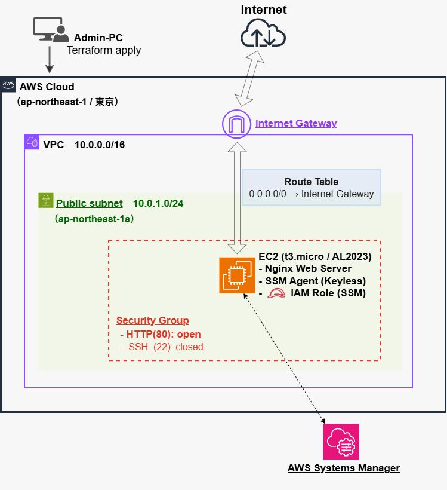

# AWSにおけるインフラ自動構築の自己学習 -AWS Infrastructure via Terraform-

 IaC（Infrastructure as Code）の基礎を習得するために作成しています。
 Terraformを用い、AWS上にセキュアかつ再利用可能な、Webサーバーインフラ自動構築のIaCとなります。

------
## 💪 目的・学習方法

* 実務未経験の内容を経験0から1にするため実施しています。
  →GitHub＋Terraformを使用し、AWS上にてNW構築からサーバー起動まで自動化の実現
 （AWSアカウントについては、個人にて無料アカウントを開設）
* 各種ツール使用方法・コード等をWEBや生成AIにて調べながら学習していきました。
  →コードについては学習を優先し、意味を調べつつ手入力にて作成

★実務経験がない知識も、自己研鑽していく姿勢が伝われば幸いです。

---
## 📐 自動構築によるインフラ構成図



---
## 設計のこだわり・構築リソースのポイント

* **キーレス接続（SSH 鍵の不使用）**
  AWS Systems Manager経由でのみ安全にリモート接続できる環境を構築
（インバウンド通信については、SGにて22番ポートを完全に閉じ、80番ポートのみを許可）
　
* **最小権限の原則**
  EC2にはSSM接続に必要なIAMロール「`AmazonSSMManagedInstanceCore`」のみを付与

* **サーバー起動の完全自動化**
  最新Amazon Linux 2023のAMIを自動取得し、EC2が立ち上がると「システム更新」「Nginxインストール・起動」
　「パブリックIPアドレス自動出力」までを自動完了

* **不要ファイル・機密情報の管理**
  `.gitignore` を設定し、`.terraform/` や `.tfstate` などが Git に混入しないよう管理

---

## 🛠 使用技術・ツール

* **Cloud Provider:** AWS (Region: `ap-northeast-1`)
* **IaC Tool:** Terraform (`>= 1.0.0`)
* **OS / Software:** Amazon Linux 2023, Nginx
* **Instance Type:** `t3.micro`
* **Management & Security:** AWS Systems Manager (SSM), IAM Role
* **Version Control:** Git, GitHub

---

## 📁 ディレクトリ構成

```text
portfolio-tf/
├── .gitignore          # Git 対象外設定 (.terraform, *.tfstate 等)
├── main.tf             # AWS リソース定義 (VPC, Subnet, IGW, SG, IAM, EC2, Outputs)
├── architecture.png    # インフラ構成図画像
└── README.md           # 本ドキュメント
```

---

## 🚀 リソースの操作手順

ローカル環境（Windows / CLI）からTerraformを実行

```bash
# 1. 初期化（必要なプラグインの自動ダウンロード）
terraform init

# 2. インフラの自動構築（一発でネットワークからサーバー起動までを実行）
terraform apply

# 3. インフラの自動削除（検証終了後、不要な課金を防ぐために一括破棄）
terraform destroy
```